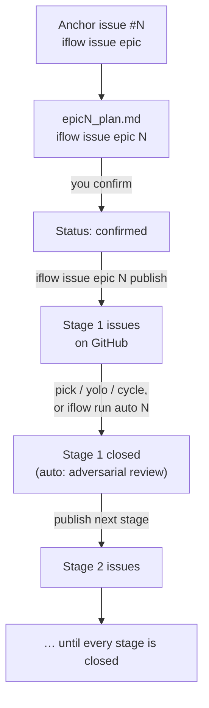

# Create and run epics

## Goal

Break a change that is too large for one PR into **staged** GitHub issues, then
run each child through the normal lifecycle (or a yolo batch / auto run).

An epic does **not** invent a second lifecycle. It only plans and publishes
children; each child still goes through capture → plan → build → close (or
yolo/cycle).

## Mental model



`iflow run drive N` runs this whole path hands-off after one confirmation.
The same structure as text:

```text
Anchor issue (#N)                 ← umbrella on GitHub; tracks progress
    └─ epic<N>_plan.md            ← local plan under .issueflows/05-epics/
         ├─ Stage 1 → issues A, B ← publish → real GitHub issues
         └─ Stage 2 → issues C, D ← publish only after Stage 1 is clear
```

| Action | Command | Writes GitHub issues? |
| --- | --- | --- |
| Create anchor | `iflow issue epic <intent>` | Yes — one umbrella issue |
| Draft / revise plan | `iflow issue epic <N>` | No — local `epic<N>_plan.md` only |
| Publish one stage | `iflow issue epic <N> publish` | Yes — that stage's children |
| Run children | `iflow pick` / `cycle` / `auto` | Via the normal issue lifecycle |

## Steps — create

1. **Anchor** — open (or already have) a GitHub issue that describes the large
   change. Or create one with `iflow issue epic <intent>` (title gets an
   `Epic:` prefix; `epic` label applied when that label exists).
2. **Draft** — `iflow issue epic <N>`. Writes
   `.issueflows/05-epics/epic<N>_plan.md` with stages, deps, and per-issue
   yolo fitness. Drafting does **not** create child GitHub issues yet.
3. **Confirm** the plan in the file (`Status: confirmed`).
4. **Publish** — `iflow issue epic <N> publish` or `… publish stage <k>`. One confirm
   creates that stage's issues, applies yolo labels per the plan, and updates
   the anchor task list. Re-runs are idempotent (`Published: #<M>` recorded).

Flat parent/child without stages? Use `iflow issue split` instead of an epic.

## Steps — run a published stage

1. **One-by-one** — `iflow pick`. Epic `next_candidates` float to the top;
   then the normal linear flow (`iflow` / plan / build / close).
2. **Batch yolo** — `iflow run cycle epic <N> stage <k>` when children are marked
   `yolo: yes` in the plan (and are actually small enough).
3. **Unattended** — `iflow run auto <N>` after the plan is confirmed and a stage is
   published. Auto **only** runs epics: it cycles the stage, then adversarial
   review, then may advance to the next published stage when the current one is
   clear. See [Use auto mode](auto-mode.md).

Advance to the next stage only when the current stage is clear (published
children closed, no open blockers). Check anytime:

```text
issue-flow agent epic-status <N>
# or: issue-flow agent epic-status <N> --json
```

## Worked example

Want a large change such as “rewrite auth”:

```text
# 1) Anchor
iflow issue epic rewrite auth
# → GitHub #42 (Epic: …)

# 2) Draft local plan (no child issues yet)
iflow issue epic 42
# → .issueflows/05-epics/epic42_plan.md
#    Stage 1: sessions / Stage 2: OAuth …
# → you confirm → Status: confirmed

# 3) Publish only Stage 1
iflow issue epic 42 publish stage 1
# → creates #43, #44; records Published: #43 / #44; task list on #42

# 4) Run Stage 1 children
iflow pick
# … or batch if yolo-fit:
iflow run cycle epic 42 stage 1
# … or overnight:
iflow run auto 42
```

After Stage 1's children are merged and closed, continue with Stage 2 (below).

## Publish: one stage at a time

There is **no** `publish all`. Each `publish` creates **one** stage:

- `iflow issue epic <N> publish` — earliest stage whose specs still lack
  `Published: #<M>`
- `iflow issue epic <N> publish stage <k>` — that stage only

**Why:** stages are sequential. Finishing Stage 1 often changes what Stage 2
should be, so later stages stay unpublished until you are ready.

If you truly want every stage on GitHub now, call publish once per stage
(each call has its own confirm):

```text
iflow issue epic 42 publish stage 1
iflow issue epic 42 publish stage 2
iflow issue epic 42 publish stage 3
```

`## Later (unscheduled)` bullets in the plan are sketches only — they never
publish until you promote them into real `### Issue:` specs under a stage.

## After Stage 1 is finished: publish the next

1. Close Stage 1 children (PRs merged).
2. Optionally **revise** Stage 2 in the plan (see next section).
3. Publish:

```text
iflow issue epic 42 publish
# → picks earliest unpublished stage (= Stage 2 after Stage 1 is published)

# or explicit:
iflow issue epic 42 publish stage 2
```

4. Run the new children (`iflow pick`, `iflow run cycle epic 42 stage 2`, or
   `iflow run auto 42`).

## Revise an unpublished stage (e.g. Stage 2)

There is no separate “revise stage 2” command. Re-run the **draft** action:

```text
iflow issue epic 42
```

Same command as the first plan. Optional free text seeds the revision:

```text
iflow issue epic 42 rewrite stage 2 now that sessions landed; drop OAuth into Later
```

What the agent should do:

- Read `issue-flow agent epic-status 42` (and the plan file).
- **Keep** existing `Published: #<M>` lines for Stage 1 (never strip them).
- Rewrite unpublished Stage 2 specs with you; confirm again if status moved
  back to `draft` → `confirmed`.
- Then `iflow issue epic 42 publish` (or `publish stage 2`).

**Also fine:** edit `.issueflows/05-epics/epic42_plan.md` by hand. Only change
unpublished `### Issue:` blocks. Do not alter `Published: #<M>` lines.
`publish` alone never revises — it only creates from the current plan.

## Auto mode and epics

`iflow run auto <N>` is the unattended orchestrator **over a confirmed epic**. It
does not create the epic; you still draft → confirm → publish first.

```text
iflow issue epic 42                  # draft + confirm
iflow issue epic 42 publish stage 1  # children must exist
iflow run auto 42                  # cycle stage + adversarial review
iflow run auto 42 dry-run          # show queue, no confirm
iflow run auto 42 status           # print auto_status.md
```

Details, loop budget, and stop conditions: [Use auto mode](auto-mode.md).

## Don't confuse

| Tool | Role |
| --- | --- |
| `iflow issue` (no `epic`) | One normal issue |
| `iflow issue epic <intent>` | Create the **anchor** only |
| `iflow issue epic <N>` | Draft / revise the staged plan |
| `iflow issue epic <N> publish` | Create one stage's GitHub children |
| `iflow issue split` | Flat parent/child, **no** stages |
| `iflow run cycle epic <N> stage <k>` | Batch-yolo one published stage (no review loop) |
| `iflow run auto <N>` | Cycle + adversarial review + stage gate |

## Related

- [Command reference](../issue-workflow.md) — `/iflow-issue epic`, `/iflow-run cycle`, `/iflow-run auto`
- [Use auto mode](auto-mode.md) — unattended stage + review loop
- [Fast-track a small issue](yolo.md) — single-issue hands-off
- CLI: `issue-flow agent epic-status` — [CLI reference](../cli.md)
